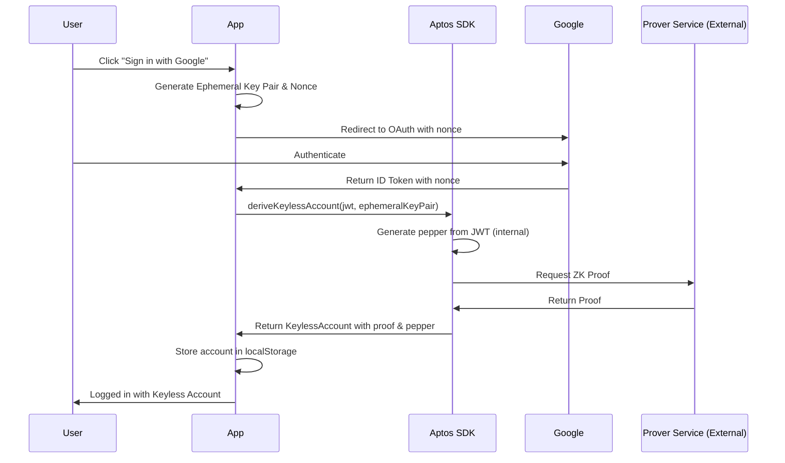

# Aptos Keyless Example

This template provides a minimal setup to get Keyless working on Vite with some ESLint rules.

## What is Aptos Keyless Authentication?

Aptos Keyless is a revolutionary authentication system that allows users to create and manage blockchain accounts using their existing social logins (like Google) without managing private keys. Instead of traditional wallet seed phrases, users authenticate via OAuth providers and derive blockchain accounts cryptographically from their identity tokens.

## How Keyless Authentication Works

### Architecture Overview

The keyless authentication flow consists of several key components:

1. **Ephemeral Key Pairs**: Temporary cryptographic keys generated client-side with an expiration time
2. **OAuth ID Tokens**: JWT tokens from identity providers (Google) containing user identity claims
3. **Zero-Knowledge Proofs**: Cryptographic proofs that verify identity without revealing sensitive information
4. **Keyless Accounts**: Blockchain accounts derived from the combination of ephemeral keys and identity proofs

### Authentication Flow



### Detailed Flow Steps

1. **Ephemeral Key Generation** (`LoginPage.tsx`):
   - App generates a temporary Ed25519 key pair with 24-hour expiration
   - Creates a unique nonce that binds the ephemeral key to the OAuth session
   - Stores ephemeral key in browser's localStorage

2. **OAuth Authentication**:
   - User redirected to Google OAuth with the nonce embedded
   - Google authenticates user and returns ID token containing:
     - User's unique identifier (`sub`)
     - The nonce linking to ephemeral key
     - User profile information
     - Token expiration time

3. **Account Derivation** (`CallbackPage.tsx` → `useKeylessAccounts.ts:144-157`):
   - App receives ID token from OAuth callback
   - Validates token and extracts nonce
   - Calls `devnetClient.deriveKeylessAccount()` which internally:
     - Generates deterministic pepper from JWT claims
     - Contacts Aptos prover service for ZK proof
     - Derives keyless account address
   - Falls back to stored pepper if initial derivation fails

4. **Account Persistence** (`useKeylessAccounts.ts`):
   - Stores derived account with proof in localStorage
   - Maintains account session until ephemeral key expires
   - Handles automatic revalidation when needed

### Key Security Features

- **No Private Key Management**: Users never see or manage private keys
- **Time-Bound Sessions**: Ephemeral keys expire after 24 hours
- **Zero-Knowledge Proofs**: Identity verification without exposing OAuth tokens on-chain
- **Pepper Service**: Additional randomness prevents account address prediction
- **Nonce Binding**: Prevents replay attacks by binding OAuth session to ephemeral key

## Configuring Google OAuth

Here are the step-by-step instructions for obtaining OAuth credentials for Google:

1. Go to the [Google Cloud Console](https://console.cloud.google.com/welcome) and sign in to your account.
2. Once you're signed in, click on the project dropdown menu in the top navigation bar and select or create the project you want to use for your OAuth credentials.
3. Click the search bar at the top of the page and search for **"OAuth consent screen"**.
4. Complete the **"Configure Consent Screen"** instructions if you haven't completed this before.
5. On the left, click **"Credentials"**. Towards the top of the screen click the **"Create Credentials"** dropdown and select **"OAuth client ID"**.
6. Select the **"Web application"** application type.
7. Enter a name for your OAuth client ID, such as **"Local Development"**.
8. In the **"Authorized JavaScript origins"** field, enter the origin of your web application: `http://localhost:5173`
9. In the **"Authorized redirect URIs"** field, enter the URI that Google should redirect users to after they authorize your application. This should be: `http://localhost:5173/callback`.
10. Click the **"Create"** button to create your OAuth client ID.
11. After creating your OAuth client ID, you should see a **"Client ID"** and **"Client Secret"** on the **"Credentials"** page. Copy the **"Client ID"** and paste it into `src/core/constants.ts`

That's it! You should now be able to authenticate with Google in your application.

If you need more help with configuring the Google OAuth App check their docs [here](https://support.google.com/cloud/answer/6158849).

## Project Structure

```
src/
├── core/                      # Core keyless authentication logic
│   ├── constants.ts          # Configuration (Google Client ID)
│   ├── ephemeral.ts          # Ephemeral key pair management
│   ├── idToken.ts            # ID token validation and parsing
│   ├── keyless.ts            # Keyless account derivation
│   ├── types.ts              # TypeScript type definitions
│   ├── useEphemeralKeyPair.ts # React hook for ephemeral keys
│   └── useKeylessAccounts.ts  # Zustand store for account management
├── pages/
│   ├── LoginPage.tsx         # Initial login with Google OAuth
│   ├── CallbackPage.tsx      # OAuth callback handler
│   └── HomePage.tsx          # Authenticated user dashboard
└── main.tsx                  # Application entry point
```

## Usage

1. **Install dependencies**:
   ```bash
   bun i
   # or
   npm install
   ```

2. **Configure Google Client ID**:
   - Follow the Google OAuth setup instructions above
   - Add your Client ID to `src/core/constants.ts`:
   ```typescript
   export const GOOGLE_CLIENT_ID = "your-client-id-here";
   ```

3. **Run the development server**:
   ```bash
   bun dev
   # or
   npm run dev
   ```

4. **Access the application**:
   - Open `http://localhost:5173` in your browser
   - Click "Sign in with Google"
   - Authenticate with your Google account
   - You'll be redirected to the home page with your keyless account address

## Technical Implementation Details

### Ephemeral Key Management
- Keys are generated using Ed25519 algorithm
- Default expiration: 24 hours from creation
- Stored in localStorage with custom serialization
- Automatically validated on retrieval

### State Management
- Uses Zustand for global state management
- Persists accounts and ephemeral keys to localStorage
- Handles account switching and disconnection
- Validates stored data on rehydration

### Service Implementation Details

#### Prover Service (External)
The prover service is an **external service** operated by Aptos Labs that generates zero-knowledge proofs:

```typescript
// In useKeylessAccounts.ts:130-135
const proofFetchCallback = async (res: ProofFetchStatus) => {
  if (res.status === "Failed") {
    get().disconnectKeylessAccount();
  } else {
    store.persist.rehydrate();  // Persist account with proof
  }
};
```

- **Location**: Called internally by `devnetClient.deriveKeylessAccount()` (line 144)
- **Purpose**: Generates ZK proof that verifies JWT ownership without exposing it on-chain
- **Network-specific**: Uses DEVNET prover service endpoint (configured in `constants.ts:10-12`)
- **Async handling**: `proofFetchCallback` monitors proof generation status
- **Required for**: Transaction signing and account verification

#### Pepper Service (SDK Internal)
The pepper "service" is **NOT an external service** but rather internal SDK functionality:

```typescript
// In useKeylessAccounts.ts:144-157
try {
  // SDK generates pepper internally (deterministically from JWT)
  activeAccount = await devnetClient.deriveKeylessAccount({
    ephemeralKeyPair,
    jwt: idToken,
    proofFetchCallback,
  });
} catch (error) {
  // Fallback: use stored pepper if SDK pepper generation fails
  activeAccount = await devnetClient.deriveKeylessAccount({
    ephemeralKeyPair,
    jwt: idToken,
    pepper: storedAccount.pepper,  // Explicitly provide pepper
    proofFetchCallback,
  });
}
```

- **Location**: Inside `@aptos-labs/ts-sdk` (v1.33.0)
- **Implementation**: Deterministic derivation from JWT claims (iss, sub, aud)
- **No external call**: Pepper is computed locally within the SDK
- **Deterministic guarantee**: Same inputs = Same pepper
  - `iss`: Always `"https://accounts.google.com"` for Google OAuth
  - `sub`: User's unique Google ID (consistent for same user)
  - `aud`: Your app's client ID (consistent for your app)
  - **Result**: Same user + same app = same pepper every time
- **Storage**: Pepper is extracted and stored locally (line 161) for consistency
- **Fallback**: Stored pepper ensures account access even if SDK changes

### Account Address Derivation
The keyless account address is deterministically derived:
1. SDK generates/uses pepper (31-byte value)
2. Combines with JWT claims: `hash(issuer + subject + audience + pepper)`
3. Same inputs = same address (ensures consistency)
4. Pepper prevents address prediction from public OAuth info

## Advantages of Keyless Accounts

1. **User-Friendly**: No seed phrases or complex wallet setup
2. **Secure**: Leverages OAuth provider's security infrastructure
3. **Recoverable**: Account access tied to social login, not seed phrases
4. **Seamless Onboarding**: Familiar login flow for mainstream users
5. **Privacy-Preserving**: Zero-knowledge proofs protect user identity

## Limitations

- Requires active internet connection for proof generation
- Dependent on OAuth provider availability
- Ephemeral keys expire and require re-authentication
- Currently supports limited OAuth providers (Google in this example)
- Cannot be exported to traditional wallets (see note below)

## Important Note: Why Keyless Accounts Can't Be Used in Traditional Wallets

### The Fundamental Difference

**Traditional Wallet Account:**
```
Private Key (permanent) → Public Key → Account Address
```

**Keyless Account:**
```
Google ID + Pepper → Account Address (no permanent private key!)
Ephemeral Key (temporary) + ZK Proof → Transaction Signing
```

The keyless account **never has a permanent private key** - it's controlled by OAuth + temporary keys + proofs. You can't export it to MetaMask-style wallets or any traditional wallet that expects a private key or seed phrase.

This is by design - the security model relies on OAuth authentication rather than private key custody. Users must always authenticate through their OAuth provider (Google) to access their keyless account.

## Resources

- [Aptos Keyless Documentation](https://aptos.dev/guides/keyless-accounts/)
- [Aptos TypeScript SDK](https://github.com/aptos-labs/aptos-ts-sdk)
- [Google OAuth Documentation](https://developers.google.com/identity/protocols/oauth2)

## Troubleshooting

### Common Issues

1. **"Invalid Client ID" Error**:
   - Ensure your Google Client ID is correctly set in `src/core/constants.ts`
   - Verify the Client ID matches your Google Cloud Console configuration

2. **Redirect URI Mismatch**:
   - Confirm `http://localhost:5173/callback` is added to authorized redirect URIs in Google Console
   - Check that your development server is running on port 5173

3. **Account Derivation Fails**:
   - Ensure you have internet connectivity for proof generation
   - Check browser console for specific error messages
   - Try clearing localStorage and re-authenticating

4. **Ephemeral Key Expired**:
   - This is expected after 24 hours
   - Simply sign in again to generate a new ephemeral key pair

## License

This example is provided for educational purposes. Please refer to the Aptos License for more information.
